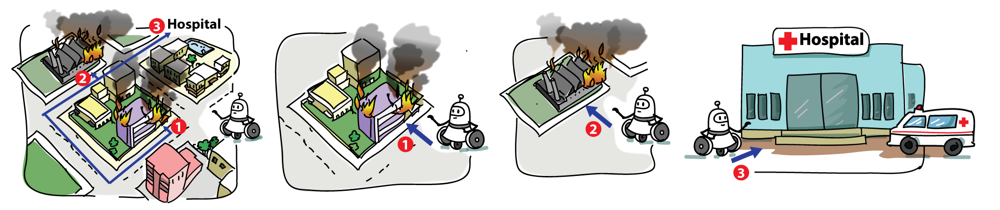

# e-Yantra Robotics Competition (eYRC 2019-20)

## Team #4717
1. [Faisal Akhtar](https://github.com/faisalAkhtar)
1. [Chandan Sharma](https://github.com/CHANDAN-KUMAR-SHARMA/)
1. [Vishal Choudhary](https://github.com/vishal146)
1. [Ritick Singh](https://github.com/riticksingh)

## Theme : Rapid Rescuer (RR)

&emsp;Rescue operations pose a grave danger to victim as well as to those assigned the job of saving the lives of victims. Rescuing people in case of fire and explosion in any cityscape comprising numerous buildings (these may be including residential, commercial, industrial, petroleum/chemical distribution, maritime, construction, and agricultural buildings etc) is a risky and crucial operation.
  
&emsp;Robots can be used in such applications to save lives of people and also provide crucial information that can further be used by experts for decision making. The purpose of Rapid Rescuer is to rescue victims from dangerous or unpleasant situations to safer locations.
  
&emsp;Motivated by this idea, in the current edition of e-Yantra Robotics Competition (eYRC 2019-20) we have designed a theme, “Rapid Rescuer”.
  
&emsp;The arena for the theme is an abstraction of a city in the form of a maze. An image of a maze will be given to teams and using Image Processing, teams have to find the shortest path from start node to final node. This information will be communicated to the Bot. The goal is to traverse the shortest path and evacuate people from different locations to a safe place whilst avoiding unknown obstacles.
  
&emsp;Challenges in this theme include:
1. Image Processing
1. Algorithm building
1. Wireless Communication
1. Building a Bot
1. Embedded C programming.
  
&emsp;The critical factor is time and the challenge is to complete the given tasks in the shortest time possible whilst incurring the least penalties. The teams that perform the task best in accordance with the rules will be declared the WINNER of the competition.
